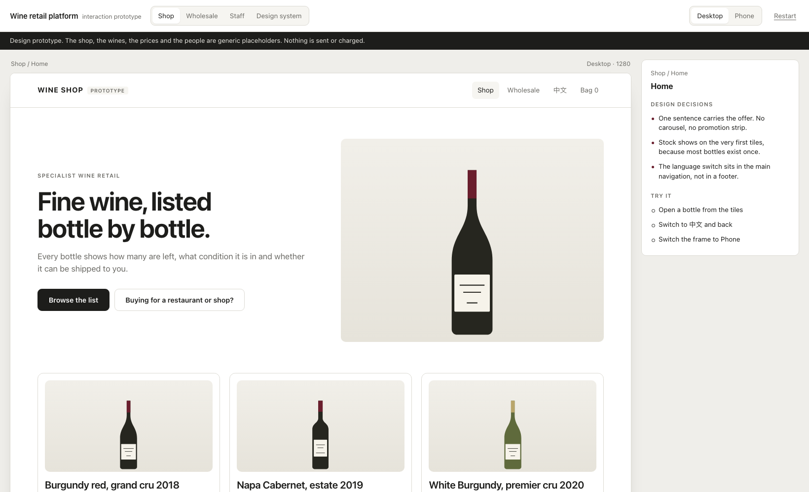
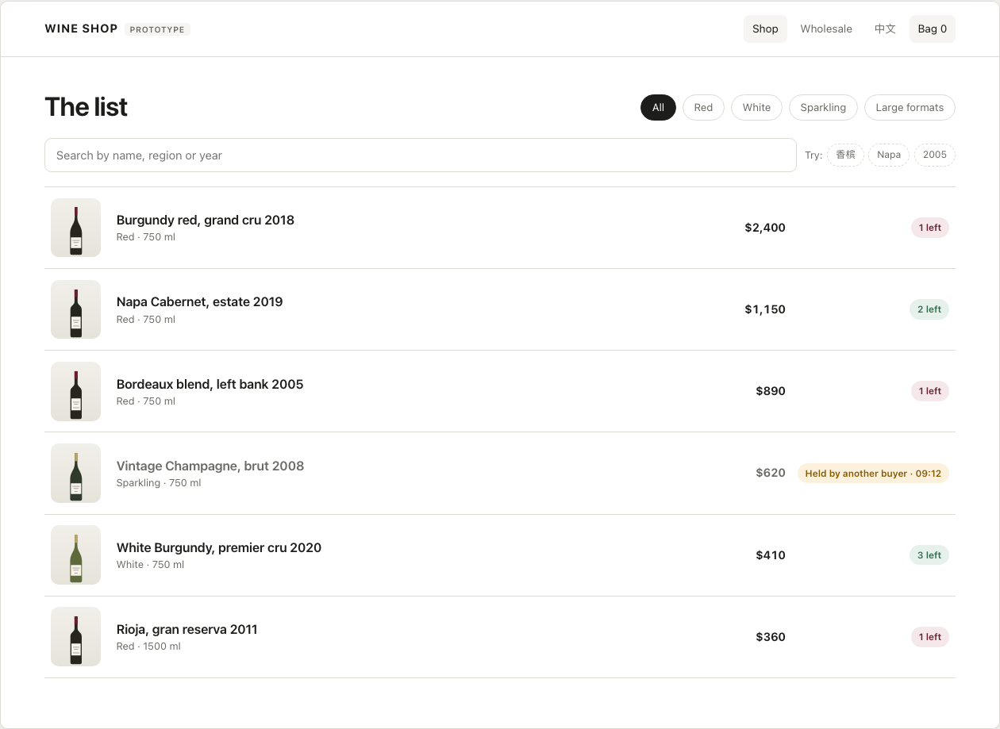
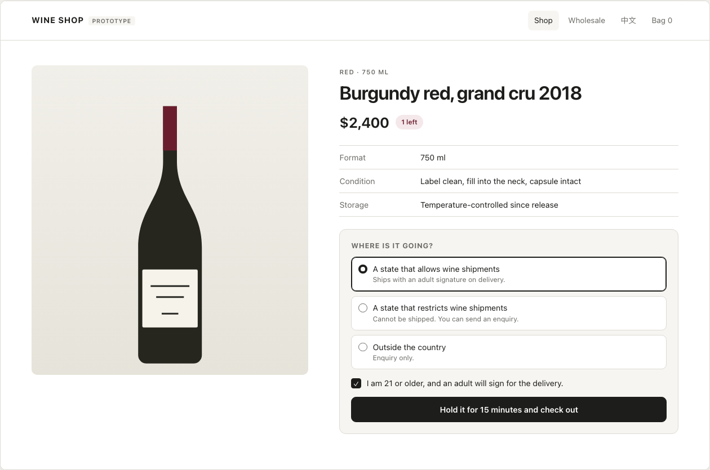
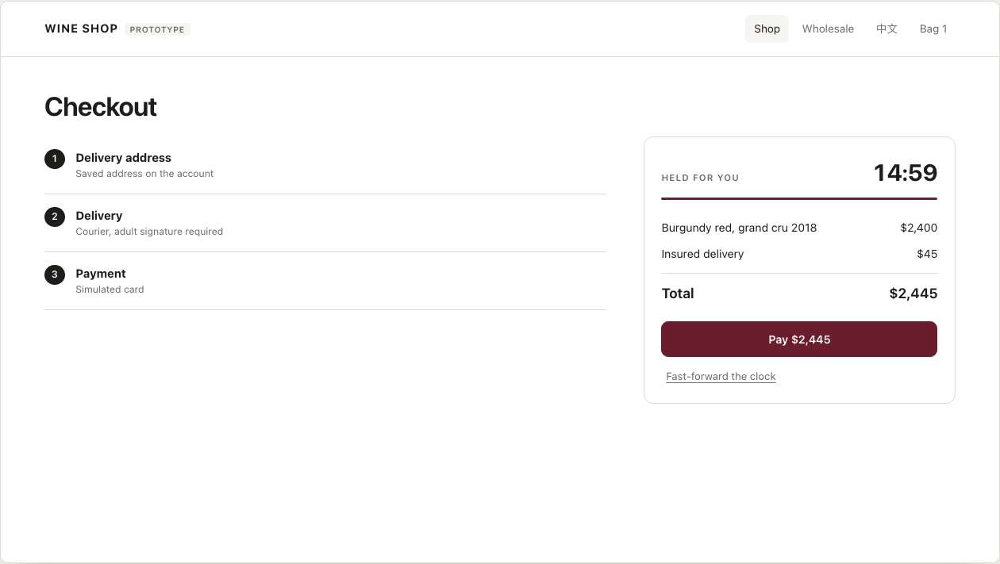
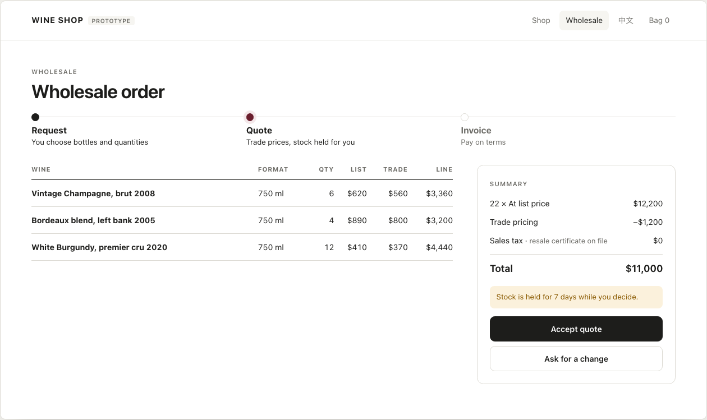
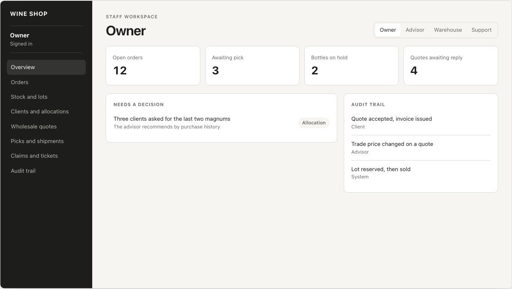
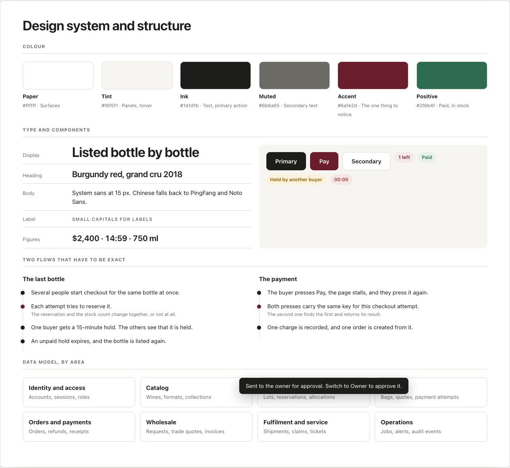

# Wine retail platform: interaction prototype

A clickable design prototype of a specialist wine shop. It shows how the shop, the wholesale desk and the staff workspace behave, screen by screen.

Open `index.html` in a browser. Nothing needs to be installed.



## What this is, and what it is not

- It is a **design prototype**: plain HTML, CSS and JavaScript, with the state kept in memory.
- The shop, the wines, the prices and the people are **generic placeholders**. Bottles are drawn, not photographed.
- It is **not** the platform's source code. The platform I designed and built is a separate, private codebase.
- Nothing is sent anywhere and nothing is charged. The page makes no network requests.

## What you can try

**Shop**

1. Open a bottle. Each one shows how many are left.
2. Choose where it is going. A destination that cannot receive wine turns the purchase into an enquiry.
3. Confirm your age. The button stays disabled until you do, and says why.
4. Hold the bottle. A 15-minute clock starts.
5. Press Pay twice. One charge is taken, and the screen says so.
6. Or fast-forward the clock and watch the hold expire. The bottle goes back on the list.

Also: search for `香槟` to find a wine listed in English by its Chinese name, and switch the whole shop between English and Chinese.

**Wholesale**

Change quantities, send a request, receive a quote that holds stock, accept it and get an invoice.

**Staff**

Switch between owner, advisor, warehouse and support. Draft a refund as support, then approve it as the owner and watch the audit trail record both steps.

**Phone**

Every screen can be switched to a 390 px phone frame.

## Screens

| | |
| --- | --- |
|  |  |
|  |  |
|  |  |

## Design decisions the prototype is there to show

- **Rules appear where the buyer decides.** Age, destination and stock are settled on the bottle page, so nothing fails late in checkout.
- **A hold is a visible clock.** The buyer knows the bottle is theirs, and for how long.
- **The last bottle cannot be sold twice.** One buyer gets the hold; everyone else sees that it is held.
- **A payment submitted twice is charged once.**
- **Each staff role has its own boundaries.** Support can draft a refund but cannot send money; the owner approves it.
- **Every change leaves an audit entry** with the role that made it.

Beside each screen, the viewer lists the decisions behind it and what to try.

## Files

```
index.html             the prototype viewer
assets/prototype.css   styles for the viewer and every screen
assets/prototype.js    screens, state and interactions
screens/               the main states exported as images
```

© Barry (Zehui) Zhang. Shared for portfolio review. Not licensed for reuse.
